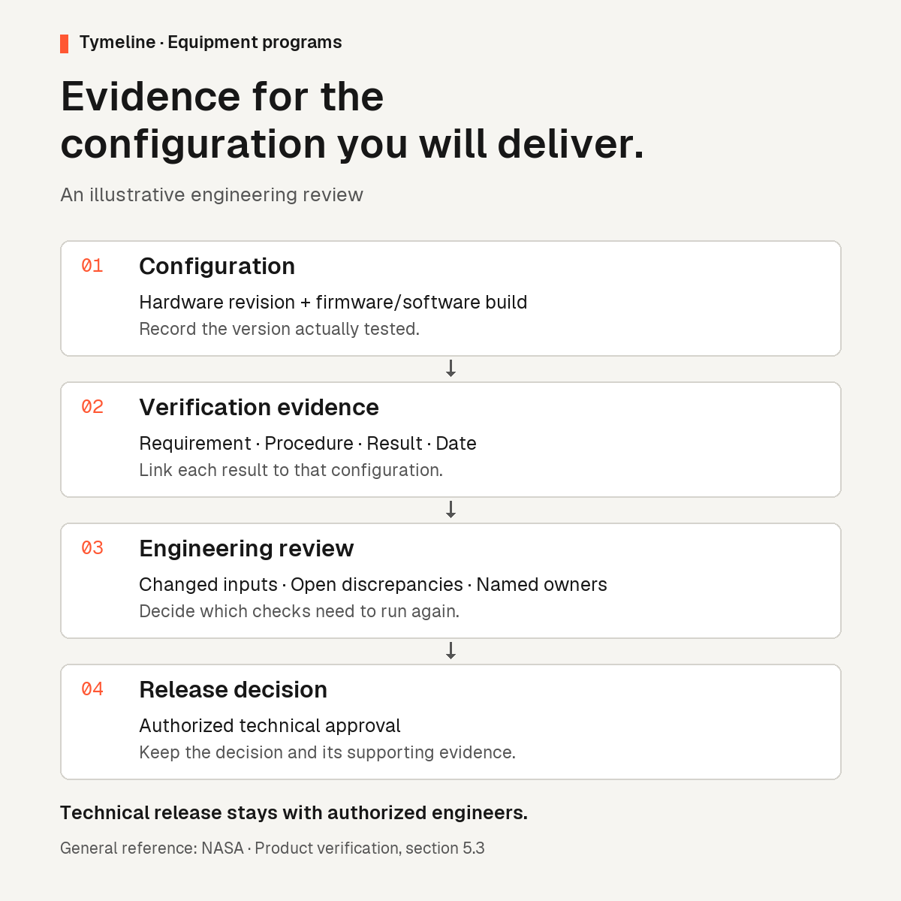

# Semiconductor program review kit

Manual worksheets from Tymeline for chip, firmware, equipment and qualification program reviews. Use the synthetic examples to evaluate evidence, dependencies and human approval.

[Download the versioned November 2026 snapshot](https://github.com/shrikarnag-q/tymeline-program-review-kit/releases/tag/worksheets-2026-11) or open the latest worksheets below. The supplier worksheet on this branch includes a newer Jira, Perforce and supplier-message pilot.

- [Equipment readiness worksheet](#semiconductor-equipment-review-worksheet) for configuration-specific verification evidence and release decisions.
- [Post-freeze engineering change worksheet](rtl-change-review.md) for impact, re-verification and approval of a proposed RTL change.
- [Customer qualification review worksheet](qualification-review.md) for reliability lots, shared test capacity and customer acceptance evidence.
- [Air-gapped AI pilot acceptance worksheet](air-gapped-ai-pilot-review.md) for local inference, identity, engineering approvals, audit recovery and offline updates.
- [Firmware sample readiness review](firmware-sample-readiness-review.md) for separating emulator work, physical bring-up and customer release decisions.
- [Supplier IP delay review](supplier-ip-delay-review.md) for tracing the effect of a revised supplier date and recording the approval.
- [Evidence-based tape-out readiness review](tape-out-readiness-review.md) for matching sign-off evidence to the release candidate and documenting pending waivers.

## Semiconductor equipment review worksheet

Published by [Tymeline](https://tymeline.ai/), which builds AI software for complex engineering programs. This manual worksheet helps a semiconductor equipment program lead prepare a configuration-specific readiness review with the authorized engineers.

Start with [the blank CSV](equipment-review-blank.csv). The [illustrative example](equipment-review-example.csv) follows a hardware revision change after an integration run. Every example identifier and result is synthetic; the observation date, owners and approval references are intentionally empty.

## Run a review

1. Record the configuration being delivered and the configuration actually tested, including the hardware revision and firmware or software build.
2. Link the applicable requirement, procedure and evidence artifact. Enter the actual observation date and the result reported by that artifact.
3. Have the responsible engineer review whether the evidence applies to the delivered configuration and decide any repeat verification.
4. Record open discrepancies, the named review owner and the next action.
5. Record the technical release approver and approval reference, plus the customer commitment decision and its authority, under the program's own rules.

The worksheet organizes a decision for review. Authorized engineers decide evidence applicability, repeat checks and technical release using the organization's approved process.

## Read the example

The illustrative integration result refers to `HW-A / FW-EXAMPLE-01`, while the intended delivery uses `HW-B / FW-EXAMPLE-01`. The applicability review and technical approval remain pending. The example makes no conclusion that the earlier result covers the new hardware revision.

Replace the illustrative references with your own controlled evidence before using the worksheet for an actual program. Keep customer and engineering records within your authorized environment.

## Field guide

| Fields | Purpose |
|---|---|
| `record_scope` | Identify illustrative or actual internal records |
| `program_reference`, `target_milestone` | Identify the program and the decision being prepared |
| `delivered_configuration`, `tested_configuration` | Keep the intended and tested versions explicit |
| `requirement_reference`, `procedure_reference` | Identify what the result addresses and how it was obtained |
| `evidence_reference`, `evidence_observed_date`, `reported_result` | Point to the actual artifact and preserve its date and reported result |
| `applicability_review`, `open_discrepancy` | Record the engineer's assessment and unresolved gaps |
| `review_owner`, `next_action` | Assign the review and its next step |
| `technical_release_approval`, `technical_release_approver`, `technical_approval_reference` | Record release status, the authorized approver and the actual approval artifact |
| `customer_commitment_decision`, `customer_commitment_approver`, `customer_decision_reference` | Record the customer commitment decision, its authority and its source |

## References and publisher

[NASA's product verification guidance](https://www.nasa.gov/reference/5-3-product-verification/) describes verification against specified requirements and the importance of a controlled configuration baseline. It is a general engineering reference for the worksheet.

[Tymeline equipment programs](https://tymeline.ai/systems) describes Tymeline's coordination across hardware, process, firmware and software. The worksheet is educational material published by Tymeline; the CSV files are manual templates with illustrative data.
